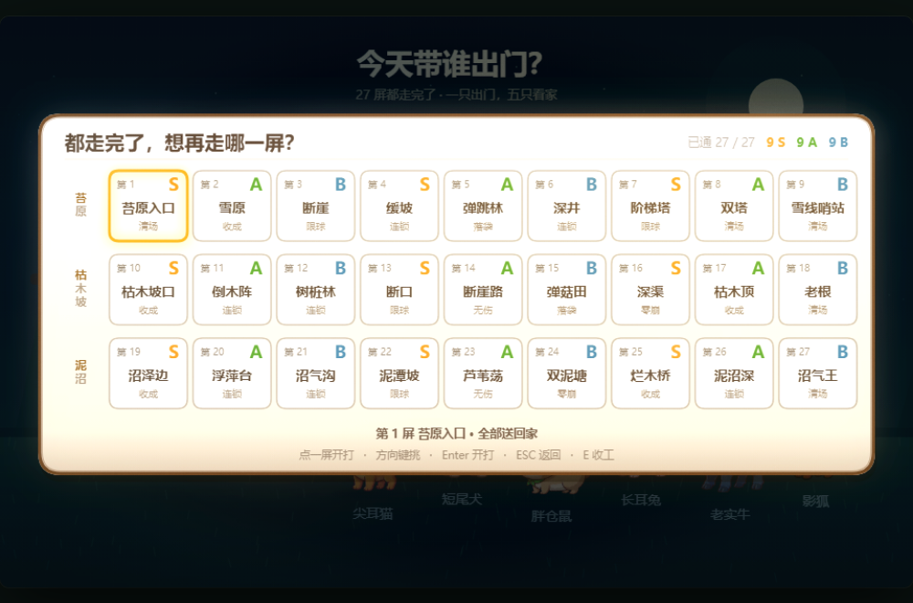
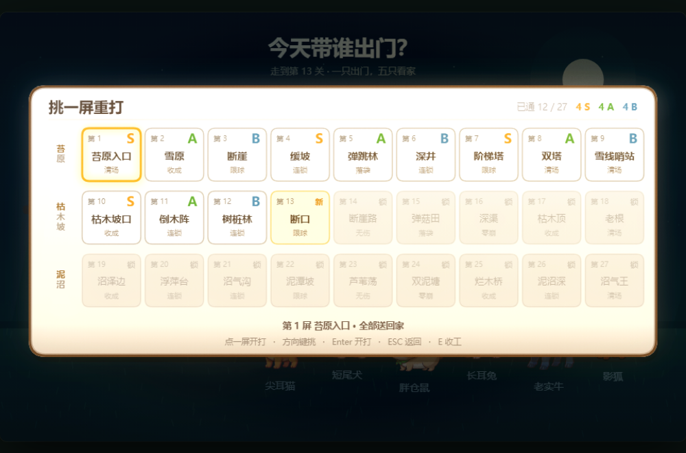
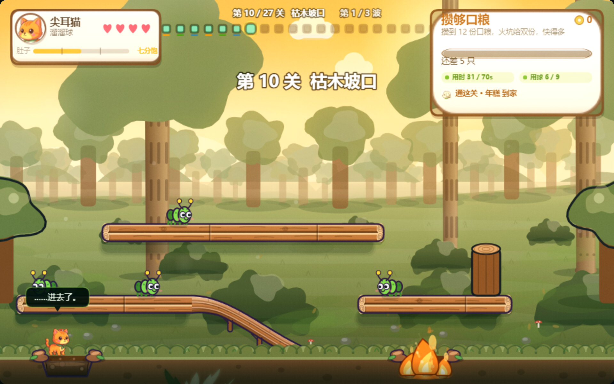

# 27 屏内容落地 + 挑一屏 + 一屏三目标 + 半饿最强

> 起因：用户问「现在通关的没得玩了吗 为什么又重新开始了 你的项目计划书是怎么决定的」，
> 随后一句「把后面的全做出来」。
>
> 本文记录这一轮**全部**落地的内容、每一步的病根与改法、以及验收结果。
> 变更已登记进 `docs/立项计划书_PAWPACK_v1.0.md` §8.1 CR-036。

---

## 0. 结论先行

| 项 | 状态 | 证据 |
|---|---|---|
| 27 屏内容（3 产地 × 8 + 3 收尾 BOSS） | **已完成** | `grove-level-audit.js` 27 行全绿（1 处刻意保留的 ⚠） |
| 6 套新产地色板（枯木坡 ×3 / 泥沼 ×3） | **已完成** | 每屏主题都能在 `THEMES` 找到，冒烟断言守着 |
| **全通不回第 1 关** | **已完成** | `progress` 上界改成 `LEVELS.length`（闭区间） |
| **挑一屏（27 格）** | **已完成** | 三处入口 + 鼠标/方向键；几何与命中同源 |
| **评级显示** | **已完成** | 挑一屏露字母；HUD 27 颗点下挂评级色条 |
| **一屏三目标** | **已完成** | 主目标 + 用时 S 线 + 用球 S 线，HUD 常驻 |
| **半饿最强** | **已完成** | 满饱 1.00 / 半饿 1.12 / 全饿 0.92，HUD 有肚子刻度条 |
| 守门四件套 | **全绿** | 681 项 / `ALL9=1` 708 项 / runtime 36 项 / tsc 4 文件 |

**没做完的**（明确列在 §7）：10 屏机器人过不去，几何合规但需人工试玩判定。

---

## 1. 27 屏是什么

`3 产地 × (8 屏 + 1 屏收尾) = 27`。不是凑出来的 3×9 —— 每个产地就是 8 屏主打 + 1 屏 BOSS 收尾。

| # | 产地 | 屏 | 主题 | 收尾屏 |
|---|---|---|---|---|
| 1–9 | 苔原 | 入口 / 雪原 / 断崖 / 缓坡 / 弹跳林 / 深井 / 阶梯塔 / 双塔 | `tundra` `snow` `cliff` `slope` `bouncy` `well` `stairs` `tower` | 9. 雪线哨站 |
| 10–18 | 枯木坡 | 枯木坡口 / 倒木阵 / 树桩林 / 断口 / 断崖路 / 弹菇田 / 深渠 / 枯木顶 | `wither1` `wither2` `wither3` | 18. 老根 |
| 19–27 | 泥沼 | 沼泽边 / 浮萍台 / 沼气沟 / 泥潭坡 / 芦苇荡 / 双泥塘 / 烂木桥 / 泥沼深 | `marsh1` `marsh2` `marsh3` | 27. 沼气王 |

七种目标在 27 屏里的分布：清场 4 / 限球 4 / 连锁 7 / 落袋 2 / 收成 5 / 零崩 2 / 无伤 2 / 收尾 BOSS 全为清场。

---

## 2. 全通不回第 1 关 —— 病根是一个数字表达不了两件事

### 病根

存档里只有一个 `pawpack.progress`，含义是"推到第几关"，取值域被写死成 `0..LEVELS.length-1`。

**于是"27 屏打完"和"一关没打"在磁盘上长得一模一样。** 具体三处：

```js
// ① goHome()：全通时把进度拍回 0
if (allClear) S.progress = 0;

// ② 从主界面进来，找"第一个没通的关"
let st = 0;
for (let i = 0; i < LEVELS.length; i++) { if (!done.has(i)) { st = i; break; } }
// 全通时循环一次都不命中，st 保持初值 0

// ③ 最后一屏通关
goHome(true);   // 直通 ①
```

玩家看到的就是"我通关了，怎么又重新开始了" —— 而且**全程没有任何提示**。

### 改法

把 `progress` 的上界放开到 `LEVELS.length`（**闭区间**），`=== LEVELS.length` 就是"全部走完"：

```js
function saveProgress() { localStorage.setItem("pawpack.progress", String(clamp(S.progress, 0, LEVELS.length))); }
function loadProgress() { if (v >= 0 && v <= LEVELS.length) S.progress = v; }
```

`allDone()` 取**两个来源的并集**（progress 到顶 ∪ 27 格评级都有）—— 只看 progress 会被老存档坑，只看 `best` 会被手改存档坑。

`goHome(allClear)` 不再归零，改成 `S.progress = Math.max(S.progress, LEVELS.length)`。

**顺带修掉一个漏发奖励的洞**：那 12 份"走完全部"的奖励原来挂在 `goHome(allClear)` 上，而结算卡点「收工回家」传的是 `goHome(false)` —— 走完最后一屏点收工 = 拿不到。现在改到**通关那一刻**发，两条路都拿得到。

---

## 3. 挑一屏

### 为什么非要有这一站

进度条能回答"我在哪"，回答不了"我还能玩什么"。全通之后、以及想重打某一屏刷评级的时候，原来的游戏里**没有一个入口**。

### 三处入口

| 入口 | 触发 |
|---|---|
| 门口选人 | 底部提示 `L 挑一屏重打`；按 `L` |
| 全通后从主界面进来 | `groveBoot()` 没有"下一个没通的关"可推 → 直接落在挑一屏 |
| 通关第 27 屏 | 结算卡主按钮从「全部通关/点这里收工」改成**「挑一屏再走 / 27 屏全通了 · 刷评级」** |

### 版式

`3 行 × 9 列`，行 = 产地，列 = 屏序。格子 82×74，行首竖排产地名。

每格三段：左上「第 N」／右上评级字母（S 金 / A 绿 / B 青灰）／中间关卡名／底部目标词。

- **锁着的格子**：灰底 + 右上一个「锁」字，点了没反应。
- **还没通的那一屏**：金色描边 + 呼吸的「新」。
- **当前光标**：金色粗描边 + 外发光。

绘制与命中**共用 `pickCell(i)` 一份几何** —— 门口那六只踩过"画一遍算一遍坐标、判定再算一遍"的坑，改布局必错开。

操作：点击 / 方向键 / `Enter` 开打 / `ESC` 返回 / `E` 收工 / `L` 收起。方向键挡了 `ev.repeat`，否则按住一秒光标从第 5 屏飞到第 27 屏。




---

## 4. 评级显示

评级原来只活在**结算卡**上 —— 一闪而过，而且只有当前这一屏。通关之后想刷 S，屏幕上没有任何地方能看到"哪几屏还是 B"。

两个地方补上：

**① 挑一屏**：字母 + 顶部汇总（`已通 27 / 27  Ｓ9 Ａ9 Ｂ9`）。

**② HUD 关卡轨迹（27 颗点）**：每颗已通的点下面挂一条 `11×3` 的评级色条。

为什么不用字母：27 个 9px 的字母在 960 宽的屏上是一片噪点，而且点间距只有 22px，第 10 屏的字母会和第 11 屏的点黏在一起。一条色条在同样间距下不互相干扰，扫一眼就是一片金色/绿色。

另外修掉一处会骗人的判定：轨迹里"有没有通过"原来读 `i < S.stage`，含义是"在第几屏之前"。有挑一屏之后它会骗人 —— 第 20 屏回头打第 3 屏，第 4..19 屏的灯全灭，看起来像存档丢了。改成读 `S.best[i]`。

---

## 5. 一屏三目标

一屏其实一直有三个目标：**主目标**（不过就判负）+ **用时压 S 线** + **用球压 S 线**。但后两个原来只活在结算卡上 —— 打的时候完全不知道自己离 S 还有多远，打完了才被告知"用时 41.2s / S 线 60s"。那是复审信息，不是能改变动作的信息。

现在后两个**常驻在右上目标卡**里：实时读秒、达标染绿、超了染褐。



目标卡尺寸 272×130 → 272×168。顺带修掉一处**真实的文字重叠**：连续条（收成 / 连锁 / 零崩 / 无伤这几关）的下沿在 y=92，而下一行「还差 N 只」12.5px 的字从中线 97 往上长到 90.75 —— 两条真的叠在一起，截图里那行字压在条的下边框上。豆子那条路径不撞（豆心下沿只到 79），所以这个错只在几关出现。BY 76→72、BH 16→14 解决。

`rate()` 口径不变（2 分 S / 1 分 A / 0 分 B），只是这三个目标现在**都在屏幕上**了。

---

## 6. 半饿最强

### 为什么非做不可

肚子掉一档是目前"贪一关"唯一的代价，但原来它只管两件**看得见**的事（跑不动、眼睛下垂）。玩家算得出来的账是"贪 = 只有坏处"，于是最优解永远是每关回家吃饭 —— 一趟连锁倍率（最多 ×2.0）就白设计了。

### 数值

```js
function bellyPower() { return [0.92, 1.12, 1.00][bellyTier()]; }  // 全饿 / 半饿 / 满饱
```

乘在 `pushPow = PUSH_BASE * (1 + PUSH_RUN * runUp) * bellyPower()` 上。

**满饱必须是 1.00，这一条不能省。** 它不是"没效果"，是这个机制的基准线：出门时肚子是满的，27 屏的落点、竖井、营地全部是按"满饱推出去多远"调出来的。给满饱一个 0.96 的"犯困"惩罚，等于把所有关卡悄悄调紧 4% —— 实测就是第 1 屏的机器人直接清不完（球差一点进不了营地）。想加惩罚不是不行，但那是"重调 27 屏"，不是"加个系数"。

形状：**满饱 = 基准，半饿 = +12%，全饿 = −8%**。够强到值得为它贪两关，又弱到不会把地图变成另一张。

### 表现

肚子原来在战斗里**完全不可见**。现在左上角色卡加了一行：`肚子 ▬▬▬|▬▬|▬▬ 七分饱`，两个刻度在 30 / 70。

没有刻度，这条只读成"还剩多少"；有了刻度，它才读成"我现在在哪一档、离下一档还有多远"。

三档各有词：`饿着呢` / `七分饱` / `刚吃饱`。**七分饱是金色的** —— 金色在这套 UI 里一直等于"好"，于是"别吃太饱"这条规则不用写一个字。

---

## 7. 关卡几何审计与不变量

19 屏一次性插进来时，43 项冒烟失败混在 800 项里根本看不出来。为此新写了独立工具：

```bash
node client/tools/grove-level-audit.js          # 27 行表格，一屏一行
node client/tools/grove-level-audit.js 12       # 第 12 屏明细：每层台面/缺口/竖井/坑/桩/营地/坡/波次
```

检查项：地面、营地、火/泥坑、木桩、竖井 `w≥55`、桩不站坑 / 不挡井、球落得到地、营地推得到（**含地面层**）、出生点站坑（⚠ 警告不判死）。

### 踩到的坑（全部付过学费）

| 症状 | 真因 |
|---|---|
| 8 屏「竖井窄 w=54」 | 462 层右段收到 880，离右墙只剩 54；球会在"撞墙弹回→被台沿接住"之间抖，永远进不了营地（852..934）。全部收到 820~830 |
| 4 屏「营地推不到」 | ①台面挡住落点 ②**审计口径漏了地面层** —— 27 屏里 17 屏没有坡，"走到地上往里推"是主路线 |
| 4 屏「桩进坑」 | 坑按 x 轴判重叠、不看高度；桩挪位或坑收窄 |
| 第 19 屏「爬不上去」 | 350 离地 206，而跳高只有 150。补两块 462 踏脚 |
| 第 9 / 27 屏 BOSS「清 2/9」 | BOSS 被整条 350 台面压在 120 宽缝里，173 颗球全崩在缝里。350 也断开，和 462 上下对齐成**通天空槽** |
| 第 21 屏「造 0 颗球」 | 350 左段正压在 462 左台头上，中间 112 缝夹着两只虫 |
| BOSS 站坑（6 屏） | 坑只对球危险、人踩实地 → "球滚过去先掉坑、BOSS 在坑里站着" = 对球免疫 |
| 第 25 屏「收成 6/13」 | 球从桥上掉到 550 一带两头都没坑，124 颗球全崩在 x=550。地面两端各加一个火坑 |

### 三条硬结论（已写进不变量）

1. **462 层右段离右墙必须留 ≥100**
2. **竖井取最宽交集**，不是第一个交集（浮萍台的装饰缝会被误判成唯一通道）
3. **营地枚举必须含地面层** `GROUND_Y`

---

## 8. 验收

```
node client/tools/grove-smoke.js                              →  681 项全过
ALL9=1 node client/tools/grove-smoke.js                       →  708 项全过
node client/tools/grove-runtime-check.js                      →  36 项全绿（33.9s）
node client/tools/ts-syntax-check.js                          →  4 文件语法通过
python client/tools/extract_grove_runtime.py  ×2              →  md5 一致（幂等）
node client/tools/grove-level-audit.js                        →  27 行全绿
```

新增 / 改写的断言组：

- **§27 挑一屏 / 全通存档语义**（17 项）：27 格全在画布内、互不重叠、中心点命中自己、锁着的点不动、选老关不回退进度、`progress===length` 即全通、全通后收工不清零、最后一屏通关进挑一屏。
- **§28 三目标 / 半饿最强**（9 项）：rate 口径三分支、半饿>满饱>全饿（倍率 + 实测推速）、三档各有词。
- `grove-runtime-check.js` 改成**结构性断言**（≥24 屏 / 首尾 id / 主题命中），不再写死关数 —— 写死 8 的时候内容一扩它就红，红的原因还跟抽取无关。

### 机器人巡回：17 / 27 达标

| 类别 | 屏 | 说明 |
|---|---|---|
| 达标 | 1,2,4,5,6,8,9,10,12,15,17,18,19,20,21,27 | — |
| 限球失败（4） | 3,7,13,22 | **设计意图**：额度比敌人数少，机器人不提前规划 |
| 无伤/零崩超时（3） | 14,16,23 | **设计意图**：机器人不会躲 |
| 超时（6） | 11,24,25,26 + 22 | 几何审计全部合规；`grove-diag` 显示剩 1~3 只够不到 |

`grove-diag.js` 对其中三屏的结论：

- 11 倒木阵：剩 1 只 @(434,556)（地面，够得到 → 机器人寻路死循环）
- 25 烂木桥：剩 1 只 @(698,350)（只能从 462 台沿跳 112 上去，人手可以，机器人不行）
- 26 泥沼深：剩 3 只，**造 169 颗球崩 162 颗**（机器人反复推空球，玩家可能同样掉进去）

---

## 9. 待办 / 未决

| 项 | 性质 |
|---|---|
| 11 / 25 / 26 三屏需**人工试玩**判定是不是真的过不去 | 阻塞点：机器人不能代表玩家 |
| 26 屏「造 169 崩 162」的推空球循环要不要在引导上加提示 | 观察 |
| 顶部三种进度表达（第 N/27 屏 / 第 X/Y 波 / 27 颗点）仍挤在一行 | 未整合，待拍板 |
| Cocos 主界面尚未验证 27 屏下的"第 N 关"文案与槽位 | 需编辑器实机确认 |
| 主界面「出发」目前只带 `cleared` 推算起始屏，尚未接挑一屏 | 下一步可选 |

---

## 附：本轮同时交付的评审图

- `client/art/04-review/03-ui/ui-pick-stage.png` —— 挑一屏（全通态）
- `client/art/04-review/03-ui/ui-pick-stage-locked.png` —— 挑一屏（只通到第 12 屏）
- `client/art/04-review/03-ui/ui-hud-three-goals.png` —— 战斗 HUD（三目标 + 肚子）
- `client/art/04-review/03-ui/ui-settle-last-stage.png` —— 最后一屏结算（改后的主按钮）
